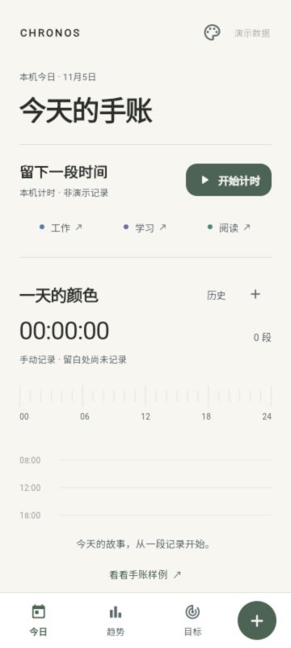
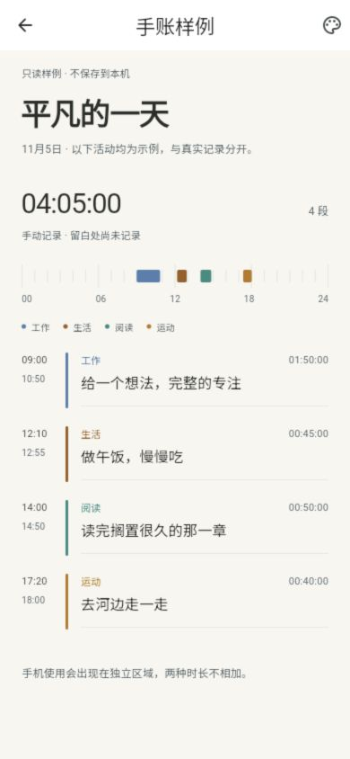

# Chronos · 柯罗诺斯

一个以图表为核心的个人时间记录应用。打开首页即可一键开始手动计时；暂停、继续、结束、分类、备注、补记和编辑都保存在本机。手动记录在 Web 演示、Android 未授权和设备数据加载期间也能使用，且始终与屏幕使用数据分开统计。仓库还包含 **Android 真实屏幕使用数据预览版** 和明确标记的 Flutter 演示模式。Android 版可在用户授予“使用情况访问权限”后展示今日、七天与近 30 天的应用前台使用统计，创建多个组合目标并为周末设不同上限；系统提醒由本地周期任务检查，实际送达仍需长期真机验证。Flutter 界面支持暮光星图、晨雾纸感、日落脉冲及跟随系统，并在本机保存选择。iOS 默认进入真实本机时间手账，尚未接入 Apple 的受保护屏幕使用报告扩展，也尚未完成 iPhone 真机验证。

当前为 **0.2.0 开发预览版**。开发者 Elton，当前版本免费；正在按双端发布标准准备，并未提交应用商店。[发布准备与验收门槛](docs/release/READINESS.md) 明确记录未完成项。

可在本地打开 [只读手账样例](http://localhost:8765/?preview=journal) 查看“时间手账＋一天的颜色”首版。样例不会保存为本机记录。

| 手账首页 | 只读样例 |
| --- | --- |
|  |  |

## 运行

安装 Flutter 3.47 或更新的稳定版，然后在仓库根目录运行：

```sh
make deps
make start                     # 构建并在后台启动 http://127.0.0.1:8765/
make run-android DEVICE=<id>   # 覆盖安装并启动 Android 调试版，签名冲突时停止
```

本地预览掉线时运行 `make restart`；用 `make status` 查看状态，`make logs` 查看日志，`make stop` 停止。`make start` 和 `make restart` 会在 Flutter 可用时重新构建；若 Flutter 暂时不可用但 `build/web/` 仍在，会启动上次成功构建的版本，并明确提示。源码修改后仍需先安装 Flutter 重新构建。也可运行 `make run-web` 在 Chrome 中调试，浏览器始终展示带标记的演示数据。`make help` 列出全部命令。若 Flutter 不在 `PATH` 中，可以指定 `FLUTTER=/path/to/flutter`。

验证代码：

```sh
make check
```

本机安装 iOS App 需要完整 Xcode；Android App 需要 Android SDK 和已配置的设备或模拟器。Web 构建仅用于快速预览界面，产品目标平台仍是 iOS 和 Android。

Android 首次启动会说明权限用途。使用时间授权由用户在系统设置中开启；创建并启用目标时才请求通知权限。目标与洞察偏好保存在设备本机，使用统计从系统读取；没有账号、后端或 AI 调用。某些设备会报告接近 24 小时的异常应用时长，Chronos 会在屏幕交互时长不支持该数值时将该日期标为不可核对，不纳入排名。

手动计时不需要屏幕使用权限。运行中的记录按起止时间恢复，不要求 App 一直留在前台；暂停时段不计入时长。可查看和修改本机记录，含暂停的记录为了避免误计时仅允许修改分类与备注，需要调整时间时可删除后补记。Android 可选择并记住“只用时间手账”，iOS 默认使用手账。原生端使用 SQLite 事务存储，首次升级校验并迁移旧偏好记录；Web 仍使用浏览器本机存储。写入失败保留上次成功状态并提示重试。

“手账设置”支持导出可恢复的 JSON 备份、供表格查看的 CSV、确认合并恢复、删除手账、使用指南与隐私说明。备份只含手动记录，不含设备使用统计、目标或外观；文件不加密，保存位置由用户选择。相同记录跳过，标识冲突或计时重叠时不修改任何记录。运行中导出生成截至导出时刻的已结束快照，本机计时继续。删除全部手账会清除进行中的计时，设备目标与系统历史不受影响；设备设置另有其数据删除入口。

## 仓库约定

所有开发提交都在 `dev` 分支完成，不创建其他开发分支。一次只允许一个编码对话修改工作区；其他模型可只读审查。具体规则见 [AGENTS.md](AGENTS.md) 和 [开发流程](docs/WORKFLOW.md)。

每次推送到 `dev` 都会触发 GitHub Actions，运行格式检查、静态分析和测试。

## 文档

- [产品范围与验收](docs/PRODUCT.md)
- [详细功能设计](docs/FUNCTIONAL_SPEC.md)
- [当前实现与验证状态](docs/IMPLEMENTATION_STATUS.md)
- [技术架构与平台数据边界](docs/ARCHITECTURE.md)
- [视觉与交互规范](docs/DESIGN.md)
- [Vibe coding 工作流程](docs/WORKFLOW.md)
- [双端发布标准与实测证据](docs/release/READINESS.md)
- [免费首版商店文案草稿](docs/release/STORE_COPY.md)

`make release-check` 检查当前发布准备状态；有未通过项时返回非零状态。`make build-aab` 要求本机正式签名环境变量，禁止退回调试证书；`make build-ios` 需要完整 Xcode 和签名配置。下一阶段是双端手账的发布构建与性能验收、Android 数据准确性和通知长期行为验证；iOS 设备使用模块另需 Family Controls entitlement、原生报告与监测。
