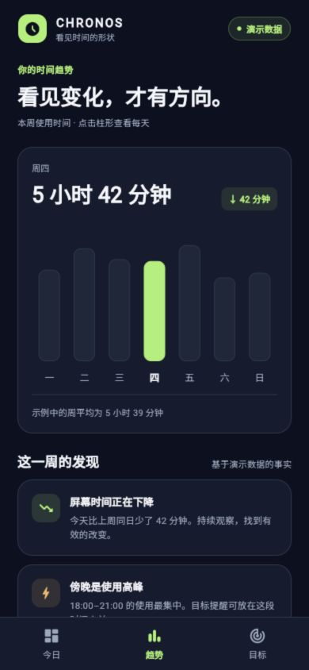
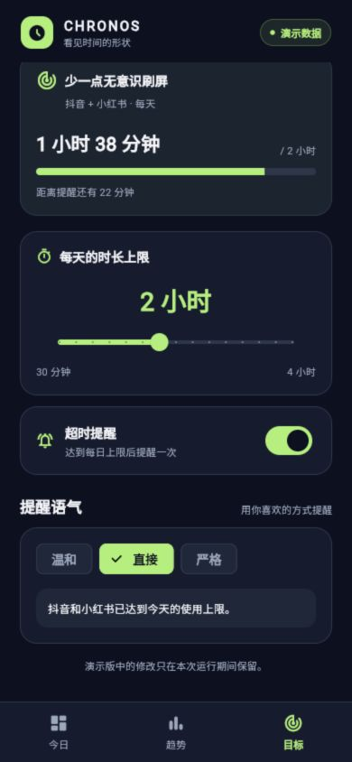

# Chronos · 柯罗诺斯

一个以图表为核心的跨平台屏幕使用时间应用。目前仓库包含 **Flutter 视觉演示版**：今日、趋势和目标三页，使用明确标记的固定演示数据。它尚未读取系统数据，也不会发送真正的超时通知。

| 今日 | 趋势 | 目标 |
| --- | --- | --- |
|  |  |  |

## 运行 Demo

安装 Flutter 3.47 或更新的稳定版，然后在仓库根目录运行：

```sh
flutter pub get
flutter run -d chrome   # 在浏览器预览界面
flutter run             # 选择已配置的 Android 或 iOS 设备
```

验证代码：

```sh
dart format --output=none --set-exit-if-changed lib test
flutter analyze
flutter test
```

本机安装 iOS App 需要完整 Xcode；Android App 需要 Android SDK 和已配置的设备或模拟器。Web 构建仅用于快速预览界面，产品目标平台仍是 iOS 和 Android。

## 仓库约定

所有开发提交都在 `dev` 分支完成，不创建其他开发分支。一次只允许一个编码对话修改工作区；其他模型可只读审查。具体规则见 [AGENTS.md](AGENTS.md) 和 [开发流程](docs/WORKFLOW.md)。

## 文档

- [产品范围与验收](docs/PRODUCT.md)
- [技术架构与平台数据边界](docs/ARCHITECTURE.md)
- [视觉与交互规范](docs/DESIGN.md)
- [Vibe coding 工作流程](docs/WORKFLOW.md)

下一阶段是先在真实 iOS 和 Android 设备上验证系统使用时长授权、报告与超时提醒，再将演示数据源替换为各平台原生实现。
