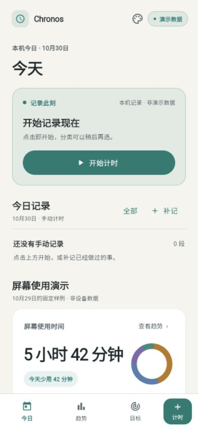

# Chronos · 柯罗诺斯

一个以图表为核心的个人时间记录应用。打开首页即可一键开始手动计时；暂停、继续、结束、分类、备注、补记和编辑都保存在本机。手动记录在 Web 演示、Android 未授权和设备数据加载期间也能使用，且始终与屏幕使用数据分开统计。仓库还包含 **Android 真实屏幕使用数据预览版** 和明确标记的 Flutter 演示模式。Android 版可在用户授予“使用情况访问权限”后展示今日、七天与近 30 天的应用前台使用统计，创建多个组合目标并为周末设不同上限；系统提醒由本地周期任务检查，实际送达仍需长期真机验证。Flutter 界面支持暮光星图、晨雾纸感、日落脉冲及跟随系统，并在本机保存选择。iOS 屏幕使用数据目前只有演示界面，尚未接入 Apple 的受保护报告扩展。

| 今日 | 趋势 | 目标 |
| --- | --- | --- |
|  |  |  |

[查看分类与平均值对比](docs/demo-categories.png)

## 运行

安装 Flutter 3.47 或更新的稳定版，然后在仓库根目录运行：

```sh
make deps
make start                     # 构建并在后台启动 http://127.0.0.1:8765/
make run-android DEVICE=<id>   # Android 真机可连接系统使用时间
```

本地预览掉线时运行 `make restart`；用 `make status` 查看状态，`make logs` 查看日志，`make stop` 停止。也可运行 `make run-web` 在 Chrome 中调试，浏览器始终展示带标记的演示数据。`make help` 列出全部命令。若 Flutter 不在 `PATH` 中，可以指定 `FLUTTER=/path/to/flutter`。

验证代码：

```sh
make check
```

本机安装 iOS App 需要完整 Xcode；Android App 需要 Android SDK 和已配置的设备或模拟器。Web 构建仅用于快速预览界面，产品目标平台仍是 iOS 和 Android。

Android 首次启动会说明权限用途。使用时间授权由用户在系统设置中开启；创建并启用目标时才请求通知权限。目标与洞察偏好保存在设备本机，使用统计从系统读取；没有账号、后端或 AI 调用。某些设备会报告接近 24 小时的异常应用时长，Chronos 会在屏幕交互时长不支持该数值时将该日期标为不可核对，不纳入排名。

手动计时不需要屏幕使用权限。运行中的记录按起止时间恢复，不要求 App 一直留在前台；暂停时段不计入时长。可查看和修改本机记录，含暂停的记录为了避免误计时仅允许修改分类与备注，需要调整时间时可删除后补记。当前手动记录使用设备本机的轻量偏好存储；正式发布前应迁移到适合长期记录的本地数据库并验证备份与恢复。删除本地数据时，手动记录也会一并清除。

## 仓库约定

所有开发提交都在 `dev` 分支完成，不创建其他开发分支。一次只允许一个编码对话修改工作区；其他模型可只读审查。具体规则见 [AGENTS.md](AGENTS.md) 和 [开发流程](docs/WORKFLOW.md)。

每次推送到 `dev` 都会触发 GitHub Actions，运行格式检查、静态分析和测试。

## 文档

- [产品范围与验收](docs/PRODUCT.md)
- [详细功能设计](docs/FUNCTIONAL_SPEC.md)
- [当前实现与验证状态](docs/IMPLEMENTATION_STATUS.md)
- [技术架构与平台数据边界](docs/ARCHITECTURE.md)
- [视觉与交互规范](docs/DESIGN.md)
- [Vibe coding 工作流程](docs/WORKFLOW.md)

下一阶段是验证 Android 目标通知的长期后台行为，并在具备完整 Xcode、iPhone 和 Family Controls entitlement 后实现 iOS 原生报告与监测。
